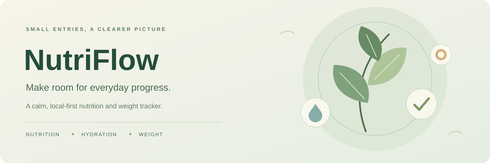
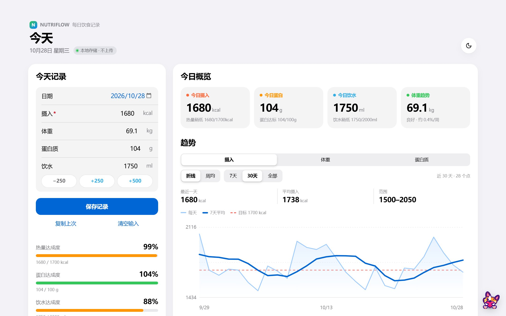
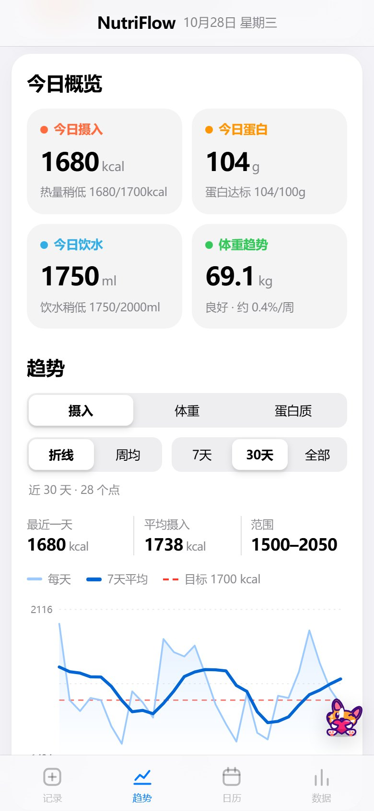
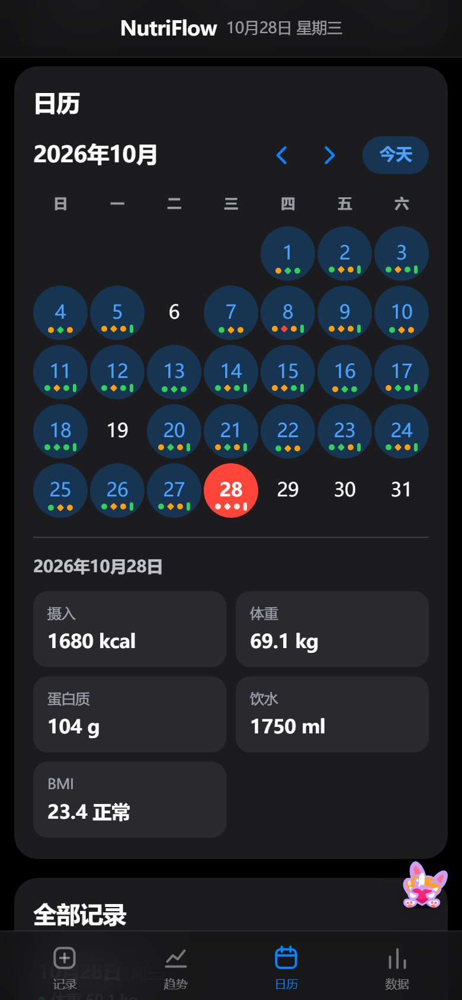
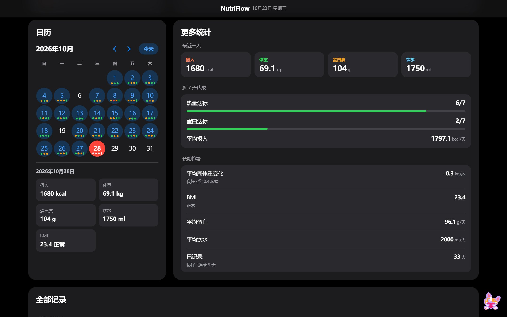

<p align="center">
  
</p>

<h1 align="center">🌿 NutriFlow</h1>

<p align="center">
  <strong>Small daily entries. A clearer view of your progress.</strong>
</p>

<p align="center">
  A calm, local-first tracker for nutrition, hydration, and weight.<br>
  Record the essentials, notice the patterns, and keep your data in your hands.
</p>

<p align="center">
  <a href="https://seiya058904.github.io/NutriFlow/"><strong>▶ Open NutriFlow</strong></a>
  &nbsp;·&nbsp;
  <a href="#a-look-inside">📸 Screenshots</a>
  &nbsp;·&nbsp;
  <a href="#the-daily-picture">📊 What You Track</a>
  &nbsp;·&nbsp;
  <a href="#choose-your-entry">💻 Online or Offline</a>
  &nbsp;·&nbsp;
  <a href="#your-data-stays-yours">🔒 Data &amp; Backups</a>
  &nbsp;·&nbsp;
  <a href="#for-developers">⚙️ Development</a>
</p>

<p align="center">
  <sub>FOUR DAILY METRICS &nbsp;·&nbsp; LONG-TERM TRENDS &nbsp;·&nbsp; LOCAL STORAGE &nbsp;·&nbsp; NO ACCOUNT REQUIRED</sub>
</p>

<p align="center">
  
</p>

---

> **Consistency is easier to understand when you can see it.**
>
> NutriFlow brings everyday records and longer-term changes into one quiet workspace. It is a personal tracking tool—not a calorie prescription, a diet plan, or a substitute for medical advice.

<a id="a-look-inside"></a>
## 📸 A Look Inside

An iOS-inspired interface: grouped entry form, at-a-glance daily cards, and a trend chart with your 7-day average and personal target (shown above).

On phones, a frosted bottom tab bar jumps between sections, and the dark mode follows the iOS graphite palette.

<table>
  <tr>
    <td width="50%" align="center">
      <br>
      <sub>Overview &amp; trends</sub>
    </td>
    <td width="50%" align="center">
      <br>
      <sub>Calendar with daily target markers</sub>
    </td>
  </tr>
</table>

<details>
<summary><strong>🌙 Dark mode on desktop</strong></summary>
<br>
<p align="center">
  
</p>
</details>

<p align="center"><sub>Screenshots use synthetic demo data.</sub></p>

<a id="the-daily-picture"></a>
## 📊 The Daily Picture

Record what matters to you, then return to see how the days fit together.

<table>
  <tr>
    <td width="50%" valign="top">
      <h3>🍽️ Calorie Intake</h3>
      <p><sub>DAILY INTAKE · PERSONAL TARGETS</sub></p>
      <p>Keep a simple record of energy intake and compare it with your own chosen target—without turning every entry into a complicated food diary.</p>
    </td>
    <td width="50%" valign="top">
      <h3>🥚 Protein</h3>
      <p><sub>GRAMS · DAILY CONSISTENCY</sub></p>
      <p>Track protein intake alongside your other daily measurements and review how consistently you meet your personal goal.</p>
    </td>
  </tr>
  <tr>
    <td width="50%" valign="top">
      <h3>💧 Water</h3>
      <p><sub>HYDRATION · MILLILITERS</sub></p>
      <p>Log daily water intake with the same lightweight workflow, keeping hydration visible next to nutrition and weight.</p>
    </td>
    <td width="50%" valign="top">
      <h3>⚖️ Weight</h3>
      <p><sub>BODY WEIGHT · CHANGE OVER TIME</sub></p>
      <p>Record weight in kilograms and look at its trend across multiple days rather than overinterpreting one measurement.</p>
    </td>
  </tr>
</table>

### ✨ More Than a Daily Number

- **📅 Calendar & streaks** — Review when you recorded information and keep your history easy to navigate.
- **📈 Trends at different scales** — Switch between 7-day, 30-day, and full-history views.
- **🌗 Light & dark** — Choose the visual theme that suits your workspace.
- **📱 Made for phones too** — A bottom tab bar, large touch targets, and charts that stay readable on narrow screens.
- **📥 Flexible imports** — Bring in existing records from supported text, CSV, or JSON formats, with a preview before applying changes.
- **🛡️ Reliable feedback** — Failed saves are surfaced instead of presenting an unsaved change as successful.

<a id="choose-your-entry"></a>
## 💻 One Tracker. Two Ways to Open It.

No application server, account, or package installation is required for everyday use. The interface is in **Simplified Chinese**; this guide is in English.

<table>
  <tr>
    <td width="50%" valign="top">
      <h3>🌐 Online — GitHub Pages</h3>
      <p><sub>OPEN IN YOUR BROWSER</sub></p>
      <p>Use the published, <strong>seed-free</strong> version directly from the website. The Pages workflow deploys the same clean single-file application used for offline distribution.</p>
      <p><strong><a href="https://seiya058904.github.io/NutriFlow/">▶ Open NutriFlow →</a></strong></p>
    </td>
    <td width="50%" valign="top">
      <h3>📄 Offline — One HTML File</h3>
      <p><sub>NO BACKEND · NO BUILD STEP</sub></p>
      <p>Open <a href="NutriFlow.html"><code>NutriFlow.html</code></a>, use GitHub's <strong>Download raw file</strong> button, then open the saved file in a compatible browser. The tracker itself needs no network connection or installed dependencies.</p>
      <p><strong><a href="NutriFlow.html">View the standalone file →</a></strong></p>
    </td>
  </tr>
</table>

> [!IMPORTANT]
> **Use the correct entry.** [`NutriFlow.html`](NutriFlow.html) is the clean, official standalone application. The repository's [`index.html`](index.html) contains **development/demo seed data** and extra PWA wiring; it is **not** the official offline distribution file. GitHub Pages publishes the clean `NutriFlow.html` content, not the seeded development entry.

<a id="your-data-stays-yours"></a>
## 🔒 Your Data Stays Yours

NutriFlow stores your records and preferences in the **current browser's `localStorage`**. Ordinary tracking does not upload your entries to a server or synchronize them with an account.

<p align="center"><code>RECORD &nbsp;→&nbsp; REVIEW &nbsp;→&nbsp; EXPORT &nbsp;→&nbsp; KEEP</code></p>

### 📦 Three Ways to Export

| Format | Best for | Includes |
| --- | --- | --- |
| **CSV** | Spreadsheets and simple record review | Daily measurements |
| **JSON** | Record-only interchange and older data formats | Daily record array |
| **Full backup** | Moving or restoring your complete tracker state | Records, personal targets, and theme |

**Moving between the website and an offline HTML file?** They do **not** automatically share data. Export a **full backup** from the original location, then import it in the destination.

> [!WARNING]
> **Local storage is not a cloud backup.** Clearing site data, switching browsers, changing devices, or using a different file origin can make existing records inaccessible. Export a full backup before making those changes. Browser behavior for `file://` storage may vary.

### 🛡️ Imports With a Safety Check

- An import is **previewed** before confirmation; matching existing dates can be deliberately overwritten.
- **Duplicate dates within the same import batch are rejected as a batch**, rather than silently choosing one record.
- Empty fields and numeric zero are treated differently when parsing structured columns.
- Full-backup restoration has rollback and recovery-journal safeguards. If recovery remains unresolved, persistent writes are paused rather than risking further damage.

These safeguards protect data integrity, but they do not replace keeping a separate exported backup.

<details>
<summary><strong>Try an import: two small, copy-ready examples</strong></summary>

**CSV or tab-separated rows** use this fixed order: `date, intake (kcal), weight (kg), protein (g), water (ml)`. Keep an empty column when a measurement is missing; do not shift later values left. These sample rows omit a header:

```csv
2026-01-01,1800,70.0,100,2000
2026-01-02,1750,,105,2100
```

**Labeled plain text** can omit optional measurements and use a different order:

```text
2026-01-02 protein 105g intake 1750kcal water 2100ml
```

Choose one example for the preview, check the field values, then confirm the import. These are sample records, not recommended personal targets.

</details>

<a id="for-developers"></a>
## ⚙️ For Developers

NutriFlow is built with **plain HTML, CSS, and JavaScript**. Each app entry contains its own markup, styles, and scripts; there is no npm package, framework build, or runtime dependency.

<details>
<summary><strong>🛠️ Expand source layout, verification &amp; release boundaries</strong></summary>

### Source map

| Path | Purpose |
| --- | --- |
| [`NutriFlow.html`](NutriFlow.html) | Canonical seed-free standalone and Pages source |
| [`index.html`](index.html) | Development/demo variant with intentional seed data and PWA integration |
| [`test-reliability.js`](test-reliability.js) | Persistence, import, backup, and shared-logic regression tests |
| [`test-parity.js`](test-parity.js) | Checks shared structure, styles, and application behavior across both HTML entries |
| [`check-html-syntax.js`](check-html-syntax.js) | Validates inline JavaScript syntax |
| [`check-repo-structure.js`](check-repo-structure.js) | Checks repository entry points and expected seed boundaries |
| [`manifest.json`](manifest.json) · [`sw.js`](sw.js) | PWA resources used by the development/demo entry |

### Verify changes

From the repository root, with Node.js available:

```bash
node test-reliability.js
node test-parity.js
node check-html-syntax.js
node check-repo-structure.js
```

For UI or storage changes, the repository also includes [`tests/browser-regressions.py`](tests/browser-regressions.py), which exercises browser workflows through Python Playwright with Chromium. These testing tools are **not** dependencies of the application itself.

The [Pages workflow](.github/workflows/pages.yml) validates the repository and publishes a clean copy of `NutriFlow.html`. When editing application behavior, keep both HTML versions aligned except for the intentional seed/PWA differences. Preserve existing storage keys, data compatibility, and transactional save/restore behavior; see [`AGENTS.md`](AGENTS.md).

</details>

## 📜 License & Scope

No repository-wide open-source license is currently declared. Public visibility does not by itself grant unrestricted permission to copy, modify, or redistribute the project.

NutriFlow is a **personal record-keeping tool**, not a medical or nutritional recommendation service. Its value is in making your own entries and trends easier to understand.

---

<p align="center">
  <sub>TRACK THE ESSENTIALS. NOTICE THE PATTERNS. KEEP YOUR DATA.</sub><br>
  <sub>NutriFlow · A quieter place for your daily progress.</sub>
</p>
