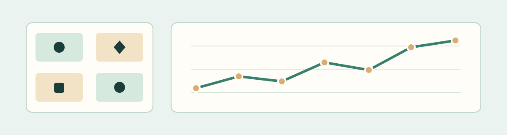
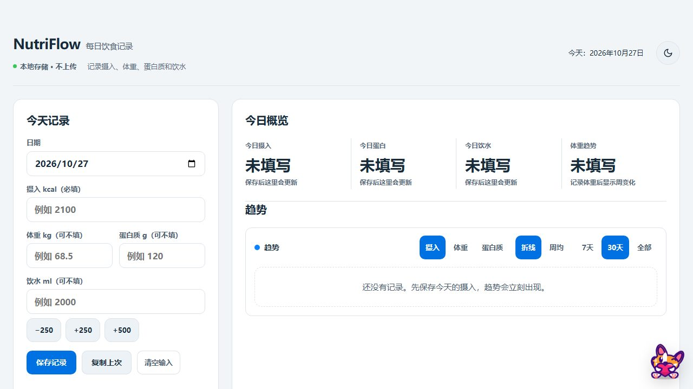
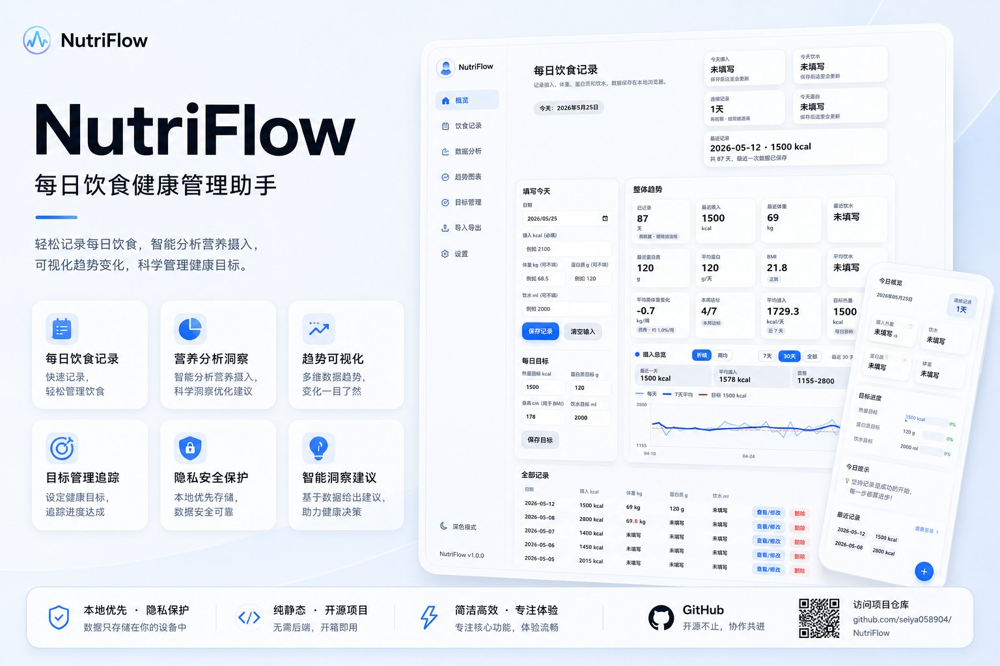

# NutriFlow

A local-first browser tracker for daily calorie intake, protein, water, and weight. Record your own measurements, review trends, and keep a backup under your control. The interface is in Chinese.

[Open online](https://seiya058904.github.io/NutriFlow/) · [Use the standalone file](#use-the-standalone-file) · [Back up your data](#data-and-backups)

*Original illustration of the tracker, not a screenshot or a record of real measurements.*

## Features

- **Record daily measurements:** enter calorie intake and optionally weight, protein, and water alongside personal targets.
- **Review patterns:** use the calendar, streaks, and short- or longer-range trend views.
- **Choose a theme:** switch between light and dark presentation.
- **Bring records in:** preview supported text, CSV, or JSON imports before applying them.
- **Keep backups:** export records as CSV or JSON, or export a full backup containing records, targets, and theme.
- **See save failures:** the interface does not present a failed persistent write as a successful save.



*Actual Chromium capture of the standalone file in a fresh browser context; no personal records are shown.*

## Use the standalone file

Download [`NutriFlow.html`](NutriFlow.html) from the repository using GitHub's raw-file download and open it in a compatible browser. It is the seed-free, single-file application: no account, server, package install, or build is required for ordinary use.

The repository's [`index.html`](index.html) is a development/demo entry with seed data and additional PWA wiring. GitHub Pages publishes the clean `NutriFlow.html` content, not that seeded entry.

## Data and backups

Records and targets are kept in the current browser's `localStorage`; ordinary tracking does not upload entries to an account. Clearing site data, changing browsers or devices, or moving between the website and a local file can make existing records unavailable. Export a **full backup** before moving or clearing data; browser behavior for `file://` storage can vary.

Imports are previewed before confirmation. Existing dates may be deliberately overwritten, but duplicate dates within one import batch are rejected. Structured CSV/TSV parsing distinguishes empty fields from numeric zero. Full-backup restoration uses rollback and a recovery journal; unresolved recovery pauses persistent writes to protect the data.

## Development and verification

The application uses plain HTML, CSS, and JavaScript; there is no package manager or build system for the app. From the repository root, with Node.js available:

```sh
node test-reliability.js
node test-parity.js
node check-html-syntax.js
node check-repo-structure.js
```

[`tests/browser-regressions.py`](tests/browser-regressions.py) provides additional browser checks using Python Playwright and Chromium; those are testing tools, not application dependencies. Preserve storage keys and the intentional seed/PWA differences between the two HTML entries when changing behavior.

## Concept art

Concept art made for this project. It is an illustration, not a screenshot, and details may differ from the shipped interface.



## License and scope

No repository-wide open-source license is declared. Public visibility does not itself grant unrestricted permission to copy, modify, or redistribute the project.

NutriFlow is a personal record-keeping tool, not a medical or nutritional recommendation service.
